# Carte de communication des agents et des skills

Cette carte décrit les **24 agents** de `agents/` et les **13 skills** de `skills/`. Elle présente deux vues complémentaires : les échanges entre agents, puis les dépendances déclarées dans leurs champs `skills:`.

## Légende

- **AGENT** : acteur qui décide, orchestre, implémente ou valide ; rectangle bleu.
- **SKILL** : règles ou savoir-faire réutilisables chargés par un agent ; rectangle arrondi vert.
- **Flèche pleine** : délégation, passage à une étape ou transmission d'un artefact entre agents.
- **Flèche pointillée** : un agent utilise un skill. Ce lien représente une dépendance documentaire, pas un échange de messages avec un acteur autonome.

Les noms des nœuds reprennent les identifiants exacts des fichiers. Les artefacts sont indiqués sur les flèches : ce ne sont ni des agents ni des skills.

## 1. Communication entre agents

Le flux principal suit le [README](README.md), complété par les contrats et les échanges explicités dans les fiches des agents. Il représente le parcours logique ; les étapes indépendantes peuvent être parallélisées et les intégrations sont activées selon le besoin. Le routeur principal peut également solliciter directement les spécialistes de sa liste de routage, sans repasser par toutes les étapes.

```mermaid
flowchart TB
    subgraph cadrage ["Cadrage et planification"]
        router["AGENT : micro-shop-router"]
        discovery["AGENT : micro-shop-project-discovery"]
        technology["AGENT : micro-shop-technology-architect"]
        planner["AGENT : micro-shop-project-planner"]
        router -->|"Brief et état du dépôt"| discovery
        discovery -->|"PROJECT_SPEC"| technology
        technology -->|"PROJECT_SPEC et TECH_STACK"| planner
    end

    subgraph conception ["Conception et intégrations"]
        visual["AGENT : micro-shop-visual-architect"]
        data["AGENT : micro-shop-data-architect"]
        commerce["AGENT : micro-shop-commerce-domain"]
        security["AGENT : micro-shop-security-auth"]
        integrations["AGENT : micro-shop-integrations-router"]
        payment["AGENT : micro-shop-payment"]
        email["AGENT : micro-shop-email"]
        media["AGENT : micro-shop-media"]
        seoDesign["AGENT : micro-shop-seo-engineer (conception)"]
        agentDesign["AGENT : micro-shop-agentification-engineer (conception)"]
        mcpDesign["AGENT : micro-shop-mcp-server-engineer (conception)"]
        integrations -->|"Paiement requis"| payment
        integrations -->|"E-mails requis"| email
        integrations -->|"Médias requis"| media
        integrations -->|"MCP requis"| mcpDesign
        seoDesign -->|"SEO_SPEC : persistance"| data
    end

    testDesign -->|"TEST_PLAN et documents de tests"| orchestrator
    planner -->|"IMPLEMENTATION_PLAN et contexte utile"| visual & data & commerce & security & integrations & seoDesign & agentDesign & mcpDesign

    subgraph implementation ["Implémentation et synchronisation"]
        orchestrator["AGENT : micro-shop-implementation-orchestrator"]
        frontoffice["AGENT : micro-shop-frontoffice-builder"]
        backoffice["AGENT : micro-shop-backoffice-builder"]
        backend["AGENT : micro-shop-backend-builder"]
        agentSync["AGENT : micro-shop-agentification-engineer (matérialisation et synchronisation)"]
        mcpBuild["AGENT : micro-shop-mcp-server-engineer (implémentation)"]
        orchestrator -->|"Lots et contrats utiles"| frontoffice & backoffice & backend
        orchestrator -->|"Matérialiser puis synchroniser après IMPLEMENTATION_RESULT"| agentSync
        agentSync -->|"AGENTIFICATION_RESULT"| orchestrator
        orchestrator -->|"MCP_SPEC : intégrer au backend"| mcpBuild
        mcpBuild -->|"MCP_IMPLEMENTATION_RESULT"| orchestrator
    end

    visual -->|"DESIGN_SYSTEM et PAGE_LAYOUTS"| orchestrator
    data -->|"DATA_MODEL"| orchestrator
    commerce -->|"DOMAIN_MODEL"| orchestrator
    security -->|"SECURITY_MODEL"| orchestrator
    payment -->|"PAYMENT_SPEC"| orchestrator
    email -->|"EMAIL_SPEC"| orchestrator
    media -->|"MEDIA_SPEC"| orchestrator
    seoDesign -->|"SEO_SPEC et SEO_BACKOFFICE_REQUEST"| orchestrator
    seoDesign -->|"SEO_SPEC"| frontoffice & backend
    seoDesign -->|"SEO_BACKOFFICE_REQUEST"| backoffice
    agentDesign -->|"AGENTIFICATION_SPEC"| orchestrator
    mcpDesign -->|"MCP_SPEC"| orchestrator
    mcpDesign -->|"MCP_SPEC"| backend

    subgraph validation ["Validation et correction"]
        qa["AGENT : micro-shop-qa"]
        testing["AGENT : micro-shop-testing-engineer (exécution)"]
        visualCheck["AGENT : micro-shop-visual-validator"]
        quality["AGENT : micro-shop-code-quality"]
        securityReview["AGENT : micro-shop-security-review"]
        seoAudit["AGENT : micro-shop-seo-engineer (audit)"]
        fixes["AGENT : micro-shop-fix-coordinator"]
        qa -->|"Suite du parcours de validation"| visualCheck & quality & securityReview & seoAudit
        qa -->|"QA_REPORT"| fixes
        testing -->|"TESTING_REPORT et preuves"| qa & quality & fixes
        visualCheck -->|"VISUAL_REPORT"| fixes
        quality -->|"QUALITY_REPORT"| fixes
        securityReview -->|"SECURITY_REVIEW"| fixes
        seoAudit -->|"SEO_REPORT"| fixes
    end

    frontoffice & backoffice & backend -->|"Code à valider"| qa
    orchestrator -->|"IMPLEMENTATION_RESULT"| qa
    orchestrator -->|"Après chaque lot et correction"| testing
    agentSync -->|"AGENTIFICATION_RESULT et fichiers à vérifier"| qa
    mcpBuild -->|"MCP_IMPLEMENTATION_RESULT et serveur à vérifier"| qa
    orchestrator -->|"IMPLEMENTATION_RESULT pour audit"| seoAudit
    fixes -->|"FIX_PLAN : corrections"| orchestrator
    fixes -->|"Tests ciblés puis suite complète et couverture avant clôture"| testing
    fixes -->|"Tous tests verts, couverture >= 90 %, autres audits validés"| reporter["AGENT : micro-shop-final-reporter"]
    fixes -->|"Après correction : validations concernées uniquement"| qa & visualCheck & quality & securityReview & seoAudit
    fixes -->|"Validé : bilan et rapports"| reporter["AGENT : micro-shop-final-reporter"]

    classDef agent fill:#DBEAFE,stroke:#2563EB,color:#172554
    class router,discovery,technology,planner,visual,data,commerce,security,integrations,payment,email,media,seoDesign,agentDesign,mcpDesign,orchestrator,frontoffice,backoffice,backend,agentSync,mcpBuild,qa,visualCheck,quality,securityReview,seoAudit,fixes,reporter agent
```

Le testing-engineer intervient avant chaque lot créé/modifié puis après chaque implémentation ou correction. Il maintient les exigences, cas, E2E et tests unitaires dans `.ai/testing/` du projet de sortie. Tout test en échec retourne aux builders via le fix-coordinator et l'implementation-orchestrator. La validation finale exige la suite complète réussie et une couverture unitaire d'au moins **90 %** selon le [contrat de tests](contracts/testing-contract.md) ; un blocage reste non validé.
`micro-shop-seo-engineer`, `micro-shop-agentification-engineer` et `micro-shop-mcp-server-engineer` peuvent apparaître à plusieurs étapes pour rendre leurs phases de conception, implémentation ou audit lisibles : il s'agit du même agent pour chaque nom, pas d'agents distincts. La liaison de QA vers les audits reprend l'enchaînement du README ; elle n'impose pas que QA orchestre lui-même tous les auditeurs.

Les agents communiquent par artefacts structurés avec seulement le contexte nécessaire, conformément aux [contrats d'échange](contracts/agent-handoff-contracts.md). `INTEGRATION_PLAN` est produit par le routeur d'intégrations et peut notamment être consommé par l'agent d'agentification. Les entrées transversales et toutes les lectures d'artefacts ne sont pas répétées dans cette vue pour préserver sa lisibilité.

## 2. Skills utilisés par chaque agent

Chaque flèche pointillée va de l'**AGENT** vers le **SKILL** qu'il déclare utiliser. Tous les agents utilisent `micro-shop-core-rules`. La déclaration d'un skill métier ne signifie pas que toutes ses fonctions sont activées : promotions, taxes et autres domaines restent conditionnés par le brief. Aucun échange autonome entre skills n'est défini dans le réseau.

```mermaid
flowchart LR
    subgraph agentsGroup ["Agents du réseau"]
        a0["AGENT : micro-shop-router"]
        a1["AGENT : micro-shop-project-discovery"]
        a2["AGENT : micro-shop-technology-architect"]
        a3["AGENT : micro-shop-project-planner"]
        a4["AGENT : micro-shop-visual-architect"]
        a5["AGENT : micro-shop-data-architect"]
        a6["AGENT : micro-shop-commerce-domain"]
        a7["AGENT : micro-shop-security-auth"]
        a8["AGENT : micro-shop-integrations-router"]
        a9["AGENT : micro-shop-payment"]
        a10["AGENT : micro-shop-email"]
        a11["AGENT : micro-shop-media"]
        a12["AGENT : micro-shop-seo-engineer"]
        a13["AGENT : micro-shop-agentification-engineer"]
        a24["AGENT : micro-shop-mcp-server-engineer"]
        a14["AGENT : micro-shop-implementation-orchestrator"]
        a15["AGENT : micro-shop-frontoffice-builder"]
        a16["AGENT : micro-shop-backoffice-builder"]
        a17["AGENT : micro-shop-backend-builder"]
        a18["AGENT : micro-shop-qa"]
        a19["AGENT : micro-shop-visual-validator"]
        a20["AGENT : micro-shop-code-quality"]
        a21["AGENT : micro-shop-security-review"]
        a22["AGENT : micro-shop-fix-coordinator"]
        a23["AGENT : micro-shop-final-reporter"]
        a24["AGENT : micro-shop-testing-engineer"]
    end
    subgraph skillsGroup ["Skills réutilisables"]
        s0("SKILL : commerce-model")
        s1("SKILL : database-ownership")
        s2("SKILL : email-delivery")
        s3("SKILL : media-pipeline")
        s4("SKILL : micro-shop-core-rules")
        s5("SKILL : order-lifecycle")
        s6("SKILL : payment-security")
        s7("SKILL : project-agentification")
        s8("SKILL : promotion-engine")
        s9("SKILL : tax-engine")
        s10("SKILL : technology-selection")
        s11("SKILL : validation-loop")
        s12("SKILL : visual-fidelity")
        s13("SKILL : mcp-server-engineering")
    end
    a0 -.-> s4
    a1 -.-> s4
    a2 -.-> s4
    a2 -.-> s10
    a2 -.-> s1
    a3 -.-> s4
    a4 -.-> s4
    a4 -.-> s12
    a5 -.-> s4
    a5 -.-> s0
    a5 -.-> s8
    a5 -.-> s9
    a5 -.-> s5
    a5 -.-> s1
    a6 -.-> s4
    a6 -.-> s0
    a6 -.-> s8
    a6 -.-> s9
    a6 -.-> s5
    a7 -.-> s4
    a7 -.-> s6
    a8 -.-> s4
    a9 -.-> s4
    a9 -.-> s6
    a10 -.-> s4
    a10 -.-> s2
    a11 -.-> s4
    a11 -.-> s3
    a12 -.-> s4
    a13 -.-> s4
    a13 -.-> s7
    a24 -.-> s4
    a24 -.-> s13
    a14 -.-> s4
    a15 -.-> s4
    a15 -.-> s12
    a16 -.-> s4
    a16 -.-> s12
    a17 -.-> s4
    a17 -.-> s0
    a17 -.-> s8
    a17 -.-> s9
    a17 -.-> s5
    a17 -.-> s1
    a17 -.-> s6
    a17 -.-> s13
    a18 -.-> s4
    a18 -.-> s11
    a19 -.-> s4
    a19 -.-> s12
    a19 -.-> s11
    a20 -.-> s4
    a20 -.-> s11
    a21 -.-> s4
    a21 -.-> s6
    a22 -.-> s4
    a22 -.-> s11
    a23 -.-> s4
    a24 -.-> s4
    a24 -.-> s11
    a24 -.-> s13
    classDef agent fill:#DBEAFE,stroke:#2563EB,color:#172554
    classDef skill fill:#DCFCE7,stroke:#16A34A,color:#14532D
    class a0,a1,a2,a3,a4,a5,a6,a7,a8,a9,a10,a11,a12,a13,a14,a15,a16,a17,a18,a19,a20,a21,a22,a23,a24 agent
    class s0,s1,s2,s3,s4,s5,s6,s7,s8,s9,s10,s11,s12,s13 skill
```

## Sources et mise à jour

- [Flux principal et philosophie du réseau](README.md).
- [Fiches des agents](agents/) : responsabilités, délégations, entrées, sorties et champs `skills:`.
- [Définitions des skills](skills/) : règles réutilisables et conditions applicables.
- [Contrat de tests et de couverture](contracts/testing-contract.md).
- [Contrats de communication](contracts/agent-handoff-contracts.md), [organisation des artefacts](contracts/artifact-layout.md) et [contrat d'agentification](contracts/agentification-contract.md) ainsi que [contrat MCP](contracts/mcp-contract.md).

Les liens de skills reflètent les déclarations actuelles des agents. Après ajout ou modification d'un agent ou d'un skill, mettre à jour les nœuds et les relations correspondantes. Les skills disponibles dans l'environnement de l'assistant mais absents de ce dépôt ne font pas partie de cette carte.

## Achat via MCP

Lorsque MCP est activé sur une boutique transactionnelle, le réseau prévoit un parcours d'achat complet via MCP : catalogue, panier, checkout, promotions/codes promo, taxes, confirmation explicite, paiement fournisseur hors bande et création/finalisation de commande. Le paiement réutilise les services métier et `PAYMENT_SPEC` ; aucun credential de paiement ne transite dans MCP.
