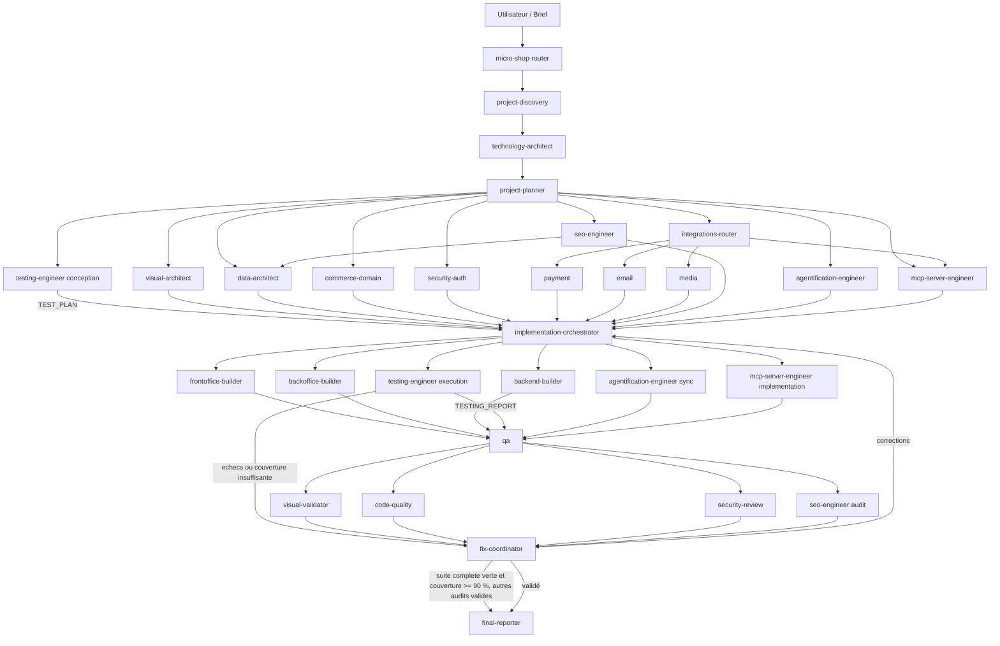

# Micro Shop Multi-Agent Network

Découpage d'un agent monolithique de génération de micro-boutiques e-commerce en réseau d'agents spécialisés.

## Arborescence

```text
micro-shop-multi-agent/
├── agents/
├── skills/
├── contracts/
└── README.md
```

## Flux principal



## Philosophie

- Les agents décident et orchestrent.
- Les skills fournissent des règles ou savoir-faire réutilisables.
- Les contrats structurés évitent de transporter tout l'historique.
- Les technologies non imposées sont choisies en fonction du projet.
- Les visuels fournis sont la source de vérité pour l'interface.
- Le SEO public est conçu puis audité par `micro-shop-seo-engineer`, qui pilote également la configuration SEO administrable du back-office.
- Toute boutique générée est agentifiée par `micro-shop-agentification-engineer` : `AGENTS.md` canonique, adaptateurs pour les principaux orchestrateurs et copie de l'intégralité du réseau courant dans `.agents/`.
- Toute création ou modification fait intervenir `micro-shop-testing-engineer` avant l'implémentation, après chaque lot et après chaque correction. Tous les tests requis doivent réussir et la couverture unitaire doit atteindre au moins **90 %** avant validation finale.
- Lorsqu'un serveur MCP est demandé, `micro-shop-mcp-server-engineer` conçoit et génère une interface MCP conforme intégrée au backend existant, sans imposer de technologie serveur particulière.
- Aucun déploiement public n'est activé implicitement.

## Agentification obligatoire des boutiques générées

Chaque boutique produite doit rester exploitable par un orchestrateur IA sans dépendre de la conversation de génération.

Le dépôt cible contient au minimum :

```text
AGENTS.md                       # source de vérité commune
CLAUDE.md                       # adaptateur Claude
GEMINI.md                       # adaptateur Gemini
.github/copilot-instructions.md # adaptateur GitHub Copilot
.junie/AGENTS.md                # adaptateur Junie
.cursor/rules/00-project.mdc    # règle Cursor
.roo/rules/00-project.md        # règle Roo Code
.windsurf/rules/00-project.md   # règle Windsurf
.agents/                        # réseau complet embarqué
.ai/                            # artefacts de décisions et de validation
```

`.agents/` embarque au minimum **tous** les fichiers `agents/`, `skills/` et `contracts/` de ce réseau au moment de la génération. Le skill `project-agentification` définit la stratégie de synchronisation et de validation.

## Exigences et tests des projets de sortie

L'[agent testing-engineer](agents/13b-micro-shop-testing-engineer.agent.md) utilise le [skill testing-engineer](skills/testing-engineer/SKILL.md) et le [contrat de tests](contracts/testing-contract.md). Il produit dans chaque projet généré :
## Model Context Protocol (MCP)

```text
.ai/testing/
├── exigences-metier.md
├── cas-de-tests.md
├── tests-e2e.md
├── tests-unitaires.md
└── rapport-validation.md
```
Le réseau sait concevoir et générer un serveur MCP intégré à la boutique via `micro-shop-mcp-server-engineer` et le skill `mcp-server-engineering`.

Chaque exigence est reliée à ses cas, chaque cas à au moins un E2E, et les documents référencent les tests exécutables écrits dans les dossiers conventionnels de la stack. `TEST_PLAN` (`.ai/test-plan.yaml`) prépare les lots ; `TESTING_REPORT` (`.ai/testing-report.yaml`) fournit les résultats et preuves.
Documentation officielle :

- https://modelcontextprotocol.io/specification
- https://modelcontextprotocol.io/docs/sdk

La révision stable doit être vérifiée au moment de l'implémentation. Le serveur MCP réutilise les services métier et le modèle de sécurité de la boutique plutôt que de dupliquer la logique applicative.

## Achat via MCP

Lorsque MCP est activé sur une boutique transactionnelle, le réseau prévoit un parcours d'achat complet via MCP : catalogue, panier, checkout, promotions/codes promo, taxes, confirmation explicite, paiement fournisseur hors bande et création/finalisation de commande. Le paiement réutilise les services métier et `PAYMENT_SPEC` ; aucun credential de paiement ne transite dans MCP.
